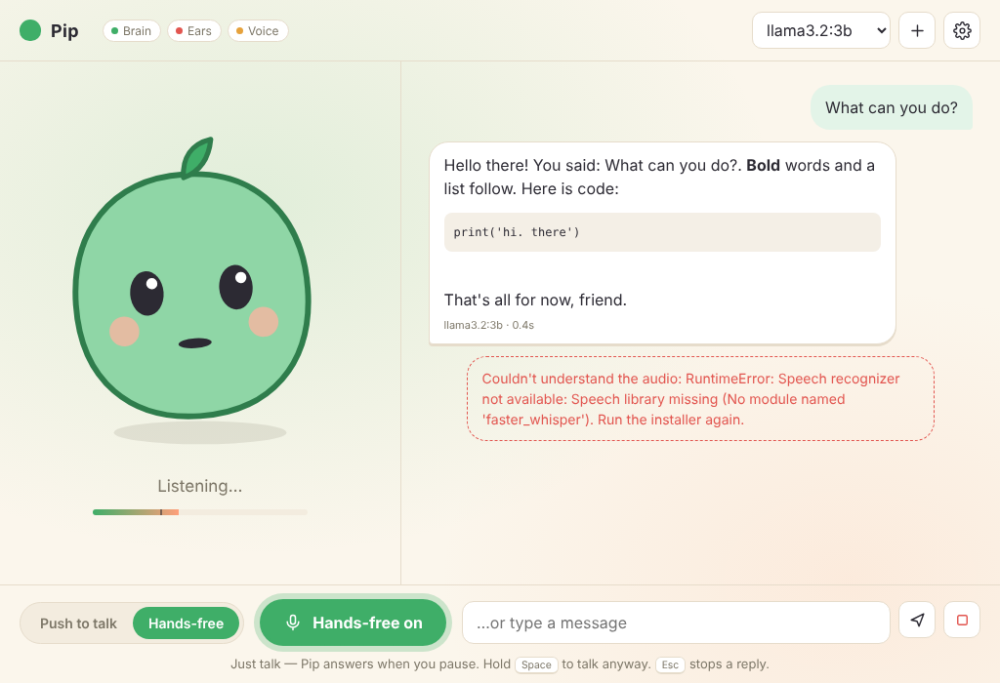

# Pip

A cheerful offline voice assistant for the Raspberry Pi 500. Talk through a headset; Pip listens, thinks and answers out loud, all on the Pi.



- **Ears:** Whisper (`base.en`, via faster-whisper)
- **Brain:** Ollama — `llama3.2:3b` by default, `llama3.2:1b` for quicker replies
- **Voice:** Piper (Amy, Joe, Alba)
- **Push to talk / Hands-free** toggle, talk-over-to-interrupt, headset picker, editable personality

## Install (64-bit Raspberry Pi OS)
```bash
git clone https://github.com/hardwaremack-prog/pip.git ~/Pip
cd ~/Pip
./install.sh
```
Needs internet once (~3.5 GB). Then use the **Pip** icon on the desktop or in the menu.

## Use
- Hold **Space** (or the button) to talk, or switch to **Hands-free** and just talk.
- **Esc** stops Pip mid-sentence. The gear menu sets mic, voice, speed and sensitivity.

See `README.txt` for troubleshooting. Log: `~/Pip/pip.log`.
